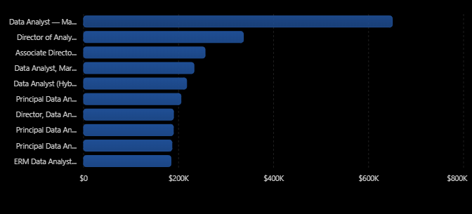
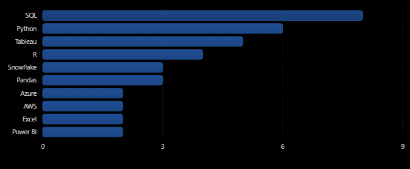

# 🎯 Introduction
This project explores the data job market, focusing on Data Analyst roles. Using SQL, it examines high-paying jobs, in-demand skills, and the skills associated with higher salaries in data analytics.

SQL queries? They're right here: [project_sql folder](/project_sql/)
# 📌 Background
As an aspiring data analyst, I wanted to understand which skills are most in demand and which offer the highest salaries. This project is my way of making that search easier for myself and others.

 The data comes from my [SQL Course](https://github.com/mbeyuclara/SQL_Project_Data_Jobs_Analysis) and contains information about job titles, salaries, locations, and required skills.

### The following research questions guided my SQL analysis:

1. What are the top-paying Data Analyst jobs?
2. What skills are required for these top-paying jobs?
3. What skills are most in demand for Data Analysts?
4. Which skills are associated with higher salaries?
5. What are the most optimal skills to learn?

# 🛠️ Tools I Used

- **SQL:** Used to query and analyze Data Analyst job postings, including salaries, job titles, and required skills. SQL was also used to identify the highest-paying jobs, most in-demand skills, highest-paying skills, and optimal skills to learn.

- **PostgreSQL:** Used as the database management system to store, manage, and query the job postings data.

- **Visual Studio Code (VS Code):** Used as the development environment to write, execute, and organize SQL queries and document the project.

- **Git and GitHub:** Used for version control and to store and showcase the project repository.

#  📈The Analysis

Each query in this project was designed to investigate a specific aspect of the Data Analyst job market. The analysis addressed five key research questions using SQL, as outlined in the following sections.

### 1. Top-Paying Data Analyst Jobs
This analysis identifies the highest-paying Data Analyst jobs by examining job titles, average annual salaries, and locations, focusing on listings marked as "Anywhere." It helps highlight high-paying opportunities in the field. 


```sql
SELECT
    job_id,
    job_title,
    job_location,
    job_schedule_type,
    salary_year_avg,
    job_posted_date,
    name AS company_name
FROM
    job_postings_fact
LEFT JOIN company_dim ON job_postings_fact.company_id = company_dim.company_id
WHERE 
    job_title_short='Data Analyst'AND
    job_location='Anywhere'AND 
    salary_year_avg IS NOT NULL
ORDER BY 
    salary_year_avg DESC
LIMIT 10;
```
 

*Figure 1: Top 10 highest-paying Data Analyst jobs based on average annual salary.*

The following are the key findings from the highest-paying Data Analyst job postings in the dataset:
- **Highest-paying listing:** The Data Analyst position at Mantys has the highest recorded annual salary at $650,000, substantially exceeding the other listings.
- **Leadership positions offer high salaries:** Director of Analytics at Meta pays $336,500, while Associate Director – Data Insights at AT&T pays $255,829.50.
- **Senior-level opportunities are prominent:** Principal Data Analyst roles at SmartAsset and Motional offer salaries ranging from $186,000 to $205,000.
- **Specialization may offer strong earning potential:** Marketing analytics and autonomous-vehicle performance analysis appear among the high-paying listings.


### 2. Skills Required for Top-Paying Jobs
This analysis examines the skills associated with the highest-paying Data Analyst positions to identify the technical skills commonly required for better-paying opportunities.


```SQL
WITH top_paying_jobs AS(
    SELECT
        job_id,
        job_title,
        salary_year_avg,
        name AS company_name
    FROM
        job_postings_fact
    LEFT JOIN company_dim ON job_postings_fact.company_id = company_dim.company_id
    WHERE 
        job_title_short='Data Analyst'AND
        job_location='Anywhere'AND 
        salary_year_avg IS NOT NULL
    ORDER BY 
        salary_year_avg DESC
    LIMIT 10
)
SELECT
    top_paying_jobs.*,
    skills
FROM top_paying_jobs
INNER JOIN skills_job_dim ON top_paying_jobs.job_id = skills_job_dim.job_id
INNER JOIN skills_dim ON skills_job_dim.skill_id = skills_dim.skill_id
ORDER BY
    top_paying_jobs.salary_year_avg DESC;

```



*Figure 2: Demanded Skills for the Top 10 highest-paying Data Analyst jobs.*

The following are the key findings on the most frequently required skills among the 10 highest-paying Data Analyst job postings in the dataset.

- **SQL** is leading with a count of 8
- **Python** follows with a count of 7
- **Tableau** is also frequently required, appeearing in 6 of the top 10 job postings.
- Other skills, including R, Snowflake, Pandas, and Excel, also appear in the top-paying job postings, although their frequencies vary.


### 3. Most In-Demand Skills
This analysis examines job postings and skill requirements to identify the skills most frequently requested by employers. The findings help reveal which technical skills aspiring data analysts should prioritize.

```SQL
SELECT
    skills,
    COUNT(skills_job_dim.job_id) AS demand_count
FROM job_postings_fact 
INNER JOIN skills_job_dim ON job_postings_fact.job_id = skills_job_dim.job_id
INNER JOIN skills_dim ON skills_job_dim.skill_id = skills_dim.skill_id
WHERE job_title_short = 'Data Analyst' AND
job_work_from_home = True
GROUP BY 
skills
ORDER BY
    demand_count DESC
LIMIT 5;
```

| Skill    | Demand Count | Interpretation                                                         |
| -------- | -----------: | ---------------------------------------------------------------------- |
| SQL      |        7,291 | SQL was mentioned in 7,291 instances across the analyzed job postings. |
| Excel    |        4,611 | Excel was mentioned 4,611 times.                                       |
| Python   |        4,330 | Python was mentioned 4,330 times.                                      |
| Tableau  |        3,745 | Tableau was mentioned 3,745 times.                                     |
| Power BI |        2,609 | Power BI was mentioned 2,609 times.                                    |

*Table 1: The Top 5 Most In-Demand Data Analyst Skills*


- **Technical and visualization skills complement each other:** SQL, Excel, and Python support data extraction, manipulation, and analysis, while Tableau and Power BI help communicate findings through visualizations and dashboards.

### 4. Highest-Paying Skills
This analysis compares the average salaries associated with different skills to identify those linked to higher earning potential in the data job market.

| No. | Skill                       | Average Salary (USD) |
| --: | --------------------------- | -------------------: |
|   1 | PySpark                     |             $208,172 |
|   2 | Bitbucket                   |             $189,155 |
|   3 | Couchbase                   |             $160,515 |
|   4 | Watson                      |             $160,515 |
|   5 | DataRobot                   |             $155,486 |
|   6 | GitLab                      |             $154,500 |
|   7 | Swift                       |             $153,750 |
|   8 | Jupyter                     |             $152,777 |
|   9 | Pandas                      |             $151,821 |
|  10 | Elasticsearch               |             $145,000 |
|  11 | Golang                      |             $145,000 |
|  12 | NumPy                       |             $143,513 |
|  13 | Databricks                  |             $141,907 |
|  14 | Linux                       |             $136,508 |
|  15 | Kubernetes                  |             $132,500 |
|  16 | Atlassian                   |             $131,162 |
|  17 | Twilio                      |             $127,000 |
|  18 | Airflow                     |             $126,103 |
|  19 | Scikit-learn                |             $125,781 |
|  20 | Jenkins                     |             $125,436 |
|  21 | Notion                      |             $125,000 |
|  22 | Scala                       |             $124,903 |
|  23 | PostgreSQL                  |             $123,879 |
|  24 | GCP (Google Cloud Platform) |             $122,500 |
|  25 | MicroStrategy               |             $121,619 |

*Table 2: The 25 Highest-Paying Skills in Data Analyst Job Postings*


```SQL
SELECT
    skills,
    ROUND(AVG(salary_year_avg), 0) AS average_salary
FROM job_postings_fact 
INNER JOIN skills_job_dim ON job_postings_fact.job_id = skills_job_dim.job_id
INNER JOIN skills_dim ON skills_job_dim.skill_id = skills_dim.skill_id
WHERE job_title_short = 'Data Analyst' AND
salary_year_avg IS NOT NULL AND 
job_work_from_home = True 
GROUP BY 
skills
ORDER BY
    average_salary DESC
LIMIT 25;
```


| No. | Skill Category                   | Examples of Skills                              | Average Salary (USD) |
| --: | -------------------------------- | ----------------------------------------------- | -------------------: |
|   1 | Big Data and Data Engineering    | PySpark, Databricks, Airflow, Scala, Kubernetes |          $146,877.00 |
|   2 | Python Ecosystem                 | Jupyter, Pandas, NumPy, Scikit-learn            |          $143,473.00 |
|   3 | Software Engineering Practices   | Bitbucket, GitLab, Jenkins, Linux               |          $154,024.75 |
|   4 | Additional Programming Languages | Swift, Go (Golang), Scala                       |          $141,217.67 |
|   5 |Specialized Data Platforms        | Couchbase, Elasticsearch, PostgreSQL, GCP       |          $137,976.00 |
|   6 | Traditional Analyst Tools        | SQL, Excel, Tableau, Power BI                   |                 N/A  |

*Table of Categories of Top-Paying Data Analyst Skills*

- **Big Data and Data Engineering:** PySpark, Databricks, Airflow, Scala, and Kubernetes feature prominently, suggesting that skills in data pipelines and large-scale data processing are valuable.

- **Python Ecosystem:** Jupyter, Pandas, NumPy, and Scikit-learn highlight the importance of Python for data manipulation, analysis, and machine learning.

- **Software Engineering Practices:** GitLab, Bitbucket, Jenkins, and Linux suggest that version control, automation, and deployment skills can complement traditional data analytics.
- **Additional Programming Languages:** Swift, Go, and Scala point to hybrid roles combining data analytics with software or product engineering.
- **Specialized Data Platforms:** Couchbase, Elasticsearch, PostgreSQL, and GCP highlight the value of knowledge in databases, search technologies, and cloud platforms.
- **Traditional Analyst Tools:** SQL, Excel, Tableau, and Power BI are absent from the top-paying skills list, suggesting that specialized technical skills may help differentiate candidates beyond foundational analytics tools.

### 5. Optimal Skills to Learn
This analysis combines skill-demand and salary information to identify skills that offer a potentially useful balance between employer demand and earning potential. The findings provide insights into which skills may be worth prioritizing when developing a career in data analytics.

```SQL
WITH skills_demand AS (
    SELECT
        skills_dim.skill_id,
        skills_dim.skills,
        COUNT(skills_job_dim.job_id) AS demand_count
    FROM job_postings_fact 
    INNER JOIN skills_job_dim ON job_postings_fact.job_id = skills_job_dim.job_id
    INNER JOIN skills_dim ON skills_job_dim.skill_id = skills_dim.skill_id
    WHERE
        job_title_short = 'Data Analyst' AND
        salary_year_avg IS NOT NULL AND
        job_work_from_home = True
    GROUP BY 
        skills_dim.skill_id
), average_salary AS (
    SELECT
        skills_job_dim.skill_id,
        ROUND(AVG(salary_year_avg), 0) AS average_salary
    FROM job_postings_fact 
    INNER JOIN skills_job_dim ON job_postings_fact.job_id = skills_job_dim.job_id
    INNER JOIN skills_dim ON skills_job_dim.skill_id = skills_dim.skill_id
    WHERE 
        job_title_short = 'Data Analyst' AND
        salary_year_avg IS NOT NULL AND 
        job_work_from_home = True 
    GROUP BY 
        skills_job_dim.skill_id
)

SELECT 
    skills_demand.skill_id,
    skills_demand.skills,
    demand_count,
    average_salary
FROM
    skills_demand
INNER JOIN average_salary ON skills_demand.skill_id = average_salary.skill_id
WHERE demand_count > 10
ORDER BY 
    average_salary DESC,
    demand_count DESC
LIMIT 25;
```
| Rank | Skill         | Demand Count | Average Salary (USD) | Reason                                                                   |
| ---: | ------------- | -----------: | -------------------: | ------------------------------------------------------------------------ |
|    1 | **Snowflake** |           37 |             $112,948 | Strong salary with relatively high demand.                               |
|    2 | **Azure**     |           34 |             $111,225 | Combines competitive pay with demand for cloud skills.                   |
|    3 | **AWS**       |           32 |             $108,317 | Good salary and demand for cloud computing expertise.                    |
|    4 | **Python**    |          236 |             $101,397 | By far the highest demand, with a competitive average salary.            |
|    5 | **Tableau**   |          230 |              $99,288 | Very high demand for data visualization skills.                          |
|    6 | **R**         |          148 |             $100,499 | Strong demand and a competitive average salary.                          |
|    7 | **Looker**    |           49 |             $103,795 | Higher demand than many specialized skills, with a solid average salary. |
|    8 | **Oracle**    |           37 |             $104,534 | Offers a balance of database-related demand and salary.                  |

The following findings highlight skills that combine relatively high demand with competitive average salaries.
- **Most optimal:** Snowflake, Azure, and AWS offer average salaries above $108,000, with demand counts exceeding 30.
- **Highest demand:** Python (236), Tableau (230), and R (148) are among the most frequently requested skills in the dataset and have competitive average salaries.
- **Promising specialization:** Cloud technologies and data warehousing are worth exploring because of their relatively high salaries and 
meaningful demand counts.

Breakdown according to category:
1. **Programming skills are important**
- Python has a demand count of 236, while R has a demand count of 148.
- These are two of the most frequently demanded skills in the dataset, suggesting that programming and 
statistical analysis are important capabilities for the roles represented.

2. **Data visualization remains relevant**
- Tableau has a demand count of 230, placing it among the most frequently demanded skills.
- This suggests that employers value the ability to present data in a clear, understandable format.

3. **Cloud and data warehouse technologies**
- Snowflake, Azure, AWS, and Oracle each have demand counts above 30.
- These technologies are relevant to data storage, data infrastructure, and cloud-based analytics.

# 📚 What I Learned

Through this project, I developed and strengthened the following skills:

* **💻 SQL Querying:** Improved my ability to write SQL queries to retrieve, filter, sort, and analyze job posting data.
* **📊 Data Aggregation:** Practiced using aggregate functions to summarize data and identify trends.
* **🔍 Data Analysis:** Strengthened my ability to investigate job market data, compare salaries, and identify the most in-demand and highest-paying skills.
* **📈 Data Visualization:** Learned how to transform query results into charts that communicate findings clearly and effectively.
* **💡 Analytical Thinking:** Improved my ability to interpret results, identify patterns, and draw meaningful insights from data.
* **📝 Technical Documentation:** Using Markdown to document SQL queries, visualizations, findings, and conclusions in a structured README.
* **🐙 GitHub and Version Control:** Organizing and presenting a data analytics project in a GitHub repository.


# 🚀 Conclusions
### Insights
The analysis revealed several important findings about the Data Analyst job market:

* **High-paying opportunities:** The dataset contained significant differences in salaries across job postings, with some senior and specialized roles offering particularly high compensation.
* **In-demand skills:** SQL, Excel, Python, Tableau, and Power BI were among the most frequently requested skills in the analyzed remote Data Analyst job postings.
* **Skills associated with higher salaries:** Specialized technologies such as PySpark, Databricks, and other data engineering and software development tools appeared among the skills associated with higher average salaries.
* **Skills to prioritize:** Snowflake, Azure, and AWS combined competitive average salaries with meaningful demand in the analyzed dataset, while Python, Tableau, and R showed particularly high demand.

### Closing Thoughts
This project provided an opportunity to apply SQL to a real-world data analysis task and explore trends in the Data Analyst job market. Through querying, aggregating, and comparing job posting data, I strengthened my SQL skills and improved my ability to interpret data and communicate meaningful findings.

The project also demonstrated how data-driven analysis can help aspiring data analysts understand employer requirements and make more informed decisions about the skills they want to develop. Moving forward, I intend to continue improving my technical skills and exploring data analytics projects that address practical questions.

Although the findings reflect the job postings included in the dataset and may not represent the entire job market, they provide a useful starting point for understanding current skill requirements and salary trends.


